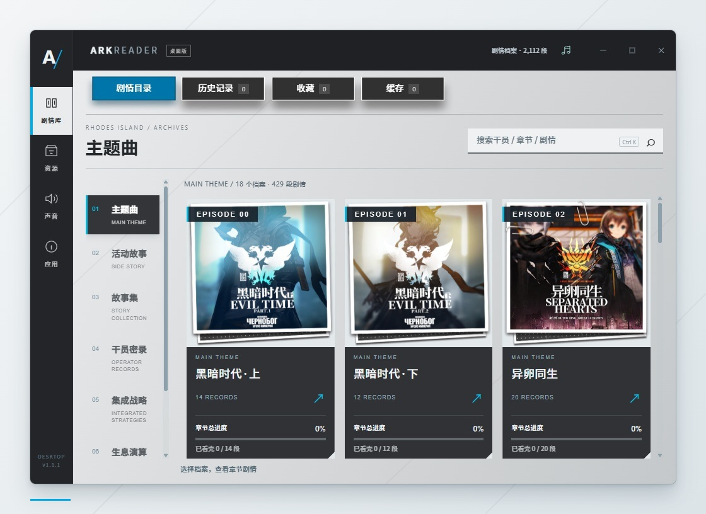
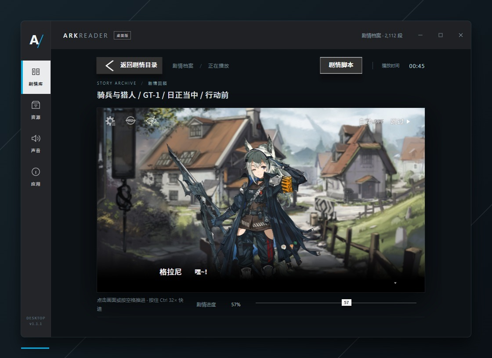
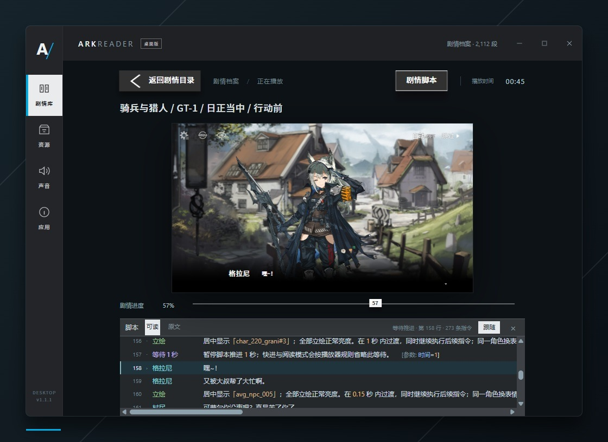
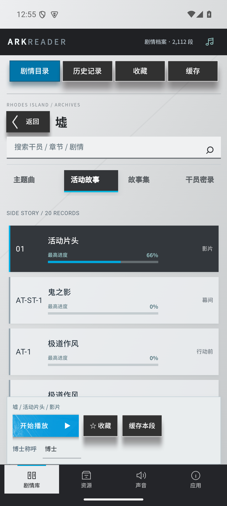
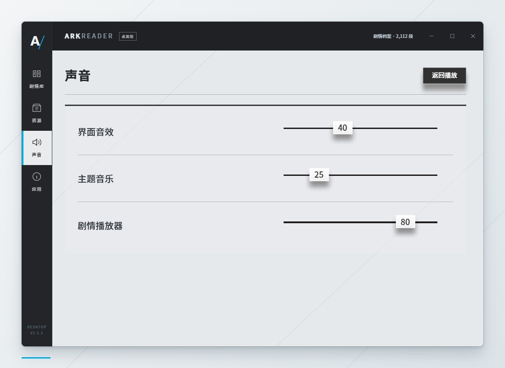

<div align="center">


<p><strong>明日方舟剧情播放器</strong></p>
<p>Windows · macOS · Linux · Android · Web<br />无需安装游戏或登录账号。</p>

[](https://github.com/djkcyl/ArkReader/releases/latest)

[下载](#下载) · [功能](#功能) · [网页部署](#网页部署) · [源码构建](#源码构建) · [反馈与贡献](#反馈与贡献)

</div>

## 下载

当前正式版 **1.2.0**。更新说明见 [Releases](https://github.com/djkcyl/ArkReader/releases/latest)。

| 平台            | 架构          | 安装版                                                                                                           | 免安装版                                                                                                          |
| --------------- | ------------- | ---------------------------------------------------------------------------------------------------------------- | ----------------------------------------------------------------------------------------------------------------- |
| Windows 10 / 11 | x64           | [EXE 安装器](https://github.com/djkcyl/ArkReader/releases/download/v1.2.0/ArkReader-1.2.0-windows-x64-setup.exe) | [便携 ZIP](https://github.com/djkcyl/ArkReader/releases/download/v1.2.0/ArkReader-1.2.0-windows-x64-portable.zip) |
| macOS 12+       | Apple Silicon | [DMG](https://github.com/djkcyl/ArkReader/releases/download/v1.2.0/ArkReader-1.2.0-macos-arm64.dmg)              | [应用 ZIP](https://github.com/djkcyl/ArkReader/releases/download/v1.2.0/ArkReader-1.2.0-macos-arm64-app.zip)      |
| Linux           | x64           | [DEB](https://github.com/djkcyl/ArkReader/releases/download/v1.2.0/ArkReader-1.2.0-linux-x64.deb)                | [AppImage](https://github.com/djkcyl/ArkReader/releases/download/v1.2.0/ArkReader-1.2.0-linux-x64.AppImage)       |
| Android 7+      | ARM64         | [APK](https://github.com/djkcyl/ArkReader/releases/download/v1.2.0/ArkReader-1.2.0-android-arm64.apk)            | —                                                                                                                 |

[Web 静态 ZIP](https://github.com/djkcyl/ArkReader/releases/download/v1.2.0/ArkReader-1.2.0-web.zip) · [SHA-256 校验清单](https://github.com/djkcyl/ArkReader/releases/download/v1.2.0/SHA256SUMS.txt) · [历史版本](https://github.com/djkcyl/ArkReader/releases)

Windows 使用系统 WebView2；macOS 应用尚未公证，首次打开可能需要在系统设置中允许运行。Linux DEB 使用 WebKitGTK 4.1。暂不提供 Intel Mac 和 iOS 版本。

## 使用

1. 安装对应平台的程序。Windows 便携版解压后运行 `ArkReader.exe`，请保留 `native` 目录。
2. 首次启动会自动下载索引、界面、封面等公共资源，完成后进入剧情库。
3. 选择剧情后播放。资源按需下载；离线使用前，可以先缓存所需剧情。

更新程序会保留资料库、设置和阅读记录。Android 请覆盖安装，卸载或清除应用数据会删除本地数据。

## 功能

### 剧情库

包含主题曲、活动故事、故事集、干员密录、集成战略、生息演算和其他剧情。支持搜索干员、章节与剧情；干员密录可按星级、职业和阵营筛选。



### 剧情播放

支持背景、立绘、CG、动画、特效、字幕、音乐、语音、音效、影片和分支选择。播放界面沿用原版布局，可切换阅读模式，支持暂停、自动播放、快进和全屏。LOG 中的对白可以点击跳转。



### 脚本查看

脚本面板位于播放器底部，可切换原文和可读解析。当前行随播放高亮，也可以点击脚本行跳转。



### 阅读记录与缓存

- 分别记录单段剧情和章节进度，支持续播和从头播放。回看不会覆盖最高进度。
- 剧情可以收藏；历史记录可以逐条删除，同时清除对应进度。
- 支持单段与批量缓存，显示下载速度、资源明细和总进度。取消后保留已下载的文件。
- 已缓存剧情可离线播放。启动时检查官方资源更新，相同资源会复用；播放前检查脚本兼容性。

### Android

支持横屏播放、触屏长按快进和系统返回。剧情加载页为全屏；剧情库的标题和分类随内容滚动，底部保留导航与播放入口。

<p align="center">
  
</p>

### 网页版

直接在浏览器中下载、解析和播放剧情，也支持手机触屏。收藏、阅读进度和缓存保存在当前浏览器中；已缓存的剧情可离线阅读。首次播放声音需要点击页面。

网页版使用 PRTS 资源源；桌面和 Android 可在「资源」页选择官方或 PRTS，相同资源会复用。切换浏览器或清除网站数据不会保留原来的阅读记录和缓存。

### 音乐与音量

主页音乐可以选择游戏内的主界面曲目。界面音效、主页音乐和剧情播放器分别调节音量；进入剧情时，主页音乐暂停。



### 操作

| 操作               | 方式                               |
| ------------------ | ---------------------------------- |
| 推进对白、补全文字 | 点击画面或空格                     |
| 快进               | 长按画面；桌面按住 Ctrl 为 32 倍速 |
| 打开、关闭脚本面板 | 「剧情脚本」按钮或 F9              |
| 回到已播放的对白   | 打开 LOG，点击对应对白             |
| 播放设置           | 画面左上角的设置按钮               |

## 数据目录

游戏资源从官方或 PRTS 在线来源下载，不读取本地游戏安装目录。资料库保存在系统用户目录，桌面安装版与便携版共用数据。

| 平台    | 资料库位置                                                      |
| ------- | --------------------------------------------------------------- |
| Windows | `%APPDATA%\io.arkreader.desktop\library`                        |
| macOS   | `~/Library/Application Support/io.arkreader.desktop/library`    |
| Linux   | `${XDG_DATA_HOME:-~/.local/share}/io.arkreader.desktop/library` |
| Android | 应用专属数据目录                                                |
| Web     | 当前站点的浏览器存储                                            |

## 已知问题

- 官方新增的剧情指令、参数或演出可能尚未适配。
- 部分 Windows 环境下偶发 WebView2 启动异常，重新打开通常可恢复，仍在排查。
- 本项目只提供剧情回放，不包含战斗、基建等游戏玩法。

## 网页部署

Release 中的 **Web ZIP** 是完整静态站点。解压后将文件原样上传到支持 HTTPS 的静态托管服务即可，不需要后端或转发服务器。也可以部署到网站子目录。

腾讯云 Makers（原 EdgeOne Pages）连接本仓库后，选择 `web` 分支，并手动填写以下构建参数：

| 项目     | 值              |
| -------- | --------------- |
| 框架     | Other           |
| 根目录   | `./`            |
| 安装命令 | `npm ci`        |
| 构建命令 | `npm run build` |
| 输出目录 | `dist`          |

`web` 分支由 Actions 在发行验证通过后更新，只保留一个提交。分支内已包含完整静态站点，构建命令只用 Node.js 将文件复制到 `dist`。开启该分支的自动部署后，新版本发布即可自动更新网站。

如需从源码编译 Web，使用 `main` 分支和 `npm run web:build:hosted`。这需要完整 Linux 构建环境，包括 Git、Python 3、C 编译器和 GNU Make；脚本会准备 Rust 与 Emscripten。Makers 的受限构建环境请使用上面的 `web` 分支方案。

## 源码构建

使用 Tauri 2、Rust、TypeScript 和 Vite，桌面、Android 与 Web 共用剧情播放器和资源引擎。

需要 Node.js 24、Rust stable 和 [Tauri 的平台依赖](https://v2.tauri.app/start/prerequisites/)。Windows 需要 C++ 构建工具和 WebView2，macOS 需要 Xcode Command Line Tools。

媒体组件从源码按需编译。Windows 另需 MSYS2 的 `make`、`diffutils` 和 `mingw-w64-ucrt-x86_64-gcc`；非默认安装位置通过 `MSYS2_ROOT` 指定。macOS 和 Linux 需要 C 编译器与 GNU Make。已编译的组件会复用。

```bash
git clone https://github.com/djkcyl/ArkReader.git
cd ArkReader
npm ci
npm start
```

| 命令                       | 用途                                      |
| -------------------------- | ----------------------------------------- |
| `npm start`                | 启动桌面开发模式                          |
| `npm run desktop:build`    | 构建当前桌面平台的安装包与免安装包        |
| `npm run desktop:portable` | 仅构建 Windows 便携版                     |
| `npm run web:build`        | 使用已配置的 Emscripten 构建静态站点      |
| `npm run web:build:hosted` | 在 Linux 构建平台准备工具链并构建静态站点 |
| `npm run build`            | TypeScript 检查与前端构建                 |
| `npm run format:check`     | 格式检查                                  |
| `npm test`                 | Rust 工作区测试                           |

[发行工作流](.github/workflows/release.yml)按 Desktop、Mobile、Web 分组构建和验证。全部通过后，在同一个 Release 发布安装包、免安装包、APK、静态 Web ZIP 和校验清单。Android 的 SDK、NDK 和签名配置见 [移动端工作流](.github/workflows/mobile.yml)。

## 反馈与贡献

问题和建议请提交到 [Issues](https://github.com/djkcyl/ArkReader/issues)。播放问题请附上系统、程序版本、剧情名称、出错位置和复现步骤，有截图或错误详情更好。

欢迎提交 PR。请说明改动和验证结果，并运行格式检查、前端构建及相关测试。

## 许可

本项目与《明日方舟》官方无隶属关系。游戏剧情、美术和音频归原权利人所有，发行包不附带游戏资源。

项目原始代码尚未指定开源许可证。第三方代码保留各自许可证，见 [第三方许可声明](licenses/README.md)。
